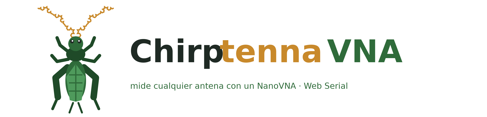

<p align="center"><picture>
  <source media="(prefers-color-scheme: dark)" srcset="img/logo-vna-oscuro.png">
  
</picture></p>

# Chirptenna VNA

[Español](README.md) · **English** · [Français](README.fr.md) · [Deutsch](README.de.md)

A web assistant to **measure an antenna with a NanoVNA** from the browser, with nothing to install: it tells you whether it
resonates where you want, whether you must **lengthen or shorten it and by how much**, and gives all its parameters (Smith
chart, impedance, SWR, phase, group delay). It works for **any antenna**; it was born inside the
[Chirptenna](https://sqtactical.github.io/chirptenna/) project (a fractal PCB antenna generator) and shares its style.

> **Status: alpha.** Tested with an emulator of the device shell and with real NanoVNA-H data, **but the driver has not yet
> been run against a connected device**. Until then, treat it as experimental.

**Use it now: <https://sqtactical.github.io/Chirptenna-VNA/>** (desktop Chrome or Edge; it has a simulated mode to try it without a device).

## What it does

- **Simple mode**: pick the band (HAM from MF to SHF, European and American ISM) or a general sweep, measure and read a
  verdict ("Lengthen the antenna by 3.2 %", "covers the band", "does not resonate within the range"…).
- **Advanced mode**: Smith chart, Z, phase, SWR, group delay, cursor, band table, CSV and Touchstone `.s1p` export, and a
  **PDF report** with the charts.
- **Single-band study with side margin** (lower edge ×(1−m), upper edge ×(1+m); 10 % by default) or a **general sweep** of
  the device's whole range (3000 points, logarithmic spacing) with automatic **refinement** around resonances.
- **Delay before measuring** so you can step away from the antenna (countdown and beeps).
- **Guided OSL calibration by segments**: calibrate the whole range at once or "in pieces", stop and continue another day;
  sets are stored in the browser and exported/imported as JSON. The app's calibration corrects the raw data and does not
  touch the device's slots.
- **Cricky**, the assistant cricket (a nod to Clippy): a discreet bubble that comments on what matters (connection,
  calibration, countdown, result). Simple mode only; closed with a click and can be muted for good.
- Weak resonances (noise, ripple on the skirt of another) are not mixed with real ones: they appear separately as
  **"possibly false"**.
- **Simulated mode with 13 example antennas** (no device): well centred, resonates low or high, badly matched, narrow,
  irregular curve, HF traps and the two typical mistakes (open cable and 50 Ω load). Picking one makes the app select
  the band that shows it best.
- **My Meshtastic node**: choose region and preset and the app computes the real frequency of your channel and judges the
  antenna there.
- **Compare antennas**: save several measurements with a name and compare them in a table and a chart.
- **Ham radio tools** (Advanced mode): L matching network with E24 values, coax and stub measurement, removing the cable
  from the measurement, Q of traps and resonators, a check of a 1:1 choke or balun and of an EFHW transformer (9:1, 49:1, 64:1), a "Live" mode to tune a tuner, and a per-band verdict for multiband antennas.
- **Expert tools**: compare with a Touchstone file (`.s1p`/`.s2p`) or with the `resultado.json` of a Chirptenna simulation
  (estimates the real εr), sweep averaging with estimated noise, and a console API (`window.chirptenna`).
- **Read the verdict aloud**.
- **Regions**: Europe (R1), the Americas (R2) and Asia-Pacific (R3, with ITU bands not checked per country).
- **Languages**: Spanish, English, French and German (selector in the header; chosen automatically from the browser or
  with `?idioma=en`). The translations were made by Claude and should be reviewed by a native speaker.

## Devices

| Device | Status |
|---|---|
| NanoVNA-H / H4 with **DiSlord** firmware 1.2.x (up to 2.7 GHz) | Supported (driver `js/drivers/nanovna-h.js`); not tried with the hardware connected |
| NanoVNA V2, V2 Plus4, F V3, LiteVNA (up to 6 GHz) | Planned: bands up to 6 GHz are already in `bandas.json`; drivers are missing |

## How to use it

You need **desktop Chrome or Edge** (Web Serial) and a page served over `https` or `localhost`.

```powershell
python -m http.server 8765
```

and open <http://localhost:8765>. Without a device, tick **"Simulated mode"**: an example antenna with two resonances and
realistic measurement errors to try the calibration.

### Test with your NanoVNA

Open **[diagnostico.html](diagnostico.html)** with the device connected: it checks the protocol, the point limit, the
timings and that the raw measurement restores the calibration, and generates a text report to paste into an issue. It never sends `save`.

## Moving antennas in and out (Chirptenna Wire and Chirptenna)

Antennas travel as ordinary files; nothing to configure. With **Chirptenna Wire** (wire antennas, NEC2):

| What | How |
|---|---|
| **Bring in the simulation** (`.s1p`) | In Wire: `python -m wire s1p <type> <MHz> --salida sim.s1p` or the *Download simulated S11* button (Simulation tab). Here, **Advanced** mode → **Compare with a Touchstone file** → pick the `.s1p`: it shows in grey over the SWR chart, with the point-by-point difference and how far the resonance is off |
| **Take your measurement out** (`.s1p`) | Measure, then in Advanced mode press **Touchstone (.s1p)**. In Wire, *Medir* tab → *Abrir .s1p medido*: it compares against the simulation and the design becomes "Measured" if the deviation is ≤ 2 % |
| **Take a cable's velocity factor out** | In **Coax and stubs**, **Download the VF for Chirptenna Wire** (`cable_*.json`). In Wire: *Abrir cable medido* (Design tab) or `--cable-medido` |

With **Chirptenna** (PCB-printed antennas) the comparison works the same way: the same **Compare with a Touchstone file** box also
accepts the `resultado.json` of a Chirptenna simulation (it compares the simulated resonance with the measured one and estimates the
real εr of the substrate). The simulation is free space with no cable: a reference, not a measurement. To compare several measured
antennas with each other use **Compare antennas**.

## Tests

```powershell
npm test
node herramientas/i18n.mjs faltan
```

Node ≥ 20, no dependencies. They cover the driver against a DiSlord shell emulator (`pruebas/emulador.mjs`), the analysis
(resonances, recommendation, bands), segmented calibration and **real data** (`pruebas/datos/`): the JS SOL correction
matches the Python one of the Chirptenna project (`vna/calibracion.py`) and a measured 868 MHz antenna gives the expected result.

## Structure

```
index.html  estilos.css  bandas.json
js/app.js          interface and measurement flow
js/analisis.js     S11 → RL, SWR, Z, delay; resonances; recommendation; bands
js/calibracion.js  3-term OSL by segments, coverage, standards check
js/asistente.js    step-by-step calibration assistant
js/grafico.js      canvas charts (RL, Smith, series)
js/informe.js      PDF report (jsPDF, loaded on demand from cdnjs)
js/i18n.js         languages: T(), selector (catalogues in idiomas/*.json; tool in herramientas/i18n.mjs)
js/drivers/        nanovna-h.js (Web Serial) and simulado.js
pruebas/           node:test, emulator and real data
```

## Known limits

- Calibration standards are assumed **ideal** (OPEN +1, SHORT −1, LOAD 0): with cheap kits there is error above
  ~1 GHz. A model with OPEN delay and capacitance is pending.
- **Band edges were written from memory**, not checked against national frequency plans. Check them before relying on
  them (regulation, power limits and channels are separate matters).
- At most 101 points per device `scan`; long sweeps are chained and take time.
- Group delay is noisy (derivative of the phase).
- **The uncertainties are indicative only.** The return-loss range comes from the calibration check and assumed typical margins; the real uncertainty may be larger. Not suitable for metrology without calibrated, traceable standards.

## Roadmap

Planned features for beginners, Meshtastic, ham radio and RF experts: [ROADMAP.md](ROADMAP.md) (in Spanish).

## License

[AGPL-3.0](LICENSE), like Chirptenna.
