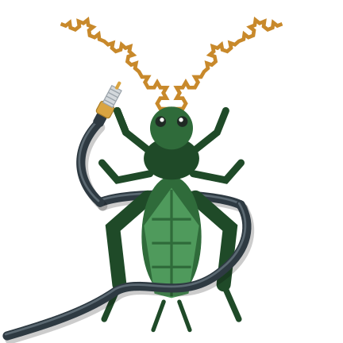

<p align="center"></p>

# Chirptenna VNA

Asistente web para **medir una antena con un NanoVNA** desde el navegador, sin instalar nada: dice si resuena donde
quieres, si hay que **alargarla o cortarla y cuánto**, y da todos sus parámetros (Smith, impedancia, VSWR, fase, retardo
de grupo). Sirve para **cualquier antena**; nació dentro del proyecto [Chirptenna](https://sqtactical.github.io/chirptenna/)
(generador de antenas fractales para PCB) y comparte su estilo.

> **Estado: alpha.** Probado con un emulador del shell del equipo y con datos reales de un NanoVNA-H, **pero el driver aún
> no se ha ejecutado contra el equipo conectado**. Hasta entonces, trátalo como experimental.

**Úsalo ahora: <https://sqtactical.github.io/Chirptenna-VNA/>** (Chrome o Edge de escritorio; tiene un modo simulado para probar sin equipo).

[English summary at the end.]

## Qué hace

- **Modo Simple**: eliges la banda (HAM de MF a SHF, ISM europeas y americanas) o un barrido general, mides y lees un
  veredicto («Alarga la antena un 3,2 %», «cubre la banda», «no resuena dentro del rango»…).
- **Modo Avanzado**: carta de Smith, Z, fase, VSWR, retardo de grupo, cursor, tabla de bandas, exportación CSV y
  Touchstone `.s1p`, e **informe PDF** con los gráficos.
- **Estudio de una banda con margen lateral** (borde inferior ×(1−m), superior ×(1+m); 10 % por defecto) o **barrido general**
  de todo el rango del equipo (3000 puntos, espaciado logarítmico) con **afinado** automático alrededor de las resonancias.
- **Retardo antes de medir** para apartarte de la antena (con cuenta atrás y pitidos).
- **Calibración guiada OSL por tramos**: puedes calibrar todo el rango de una vez o «a cachos», parar y seguir otro día;
  los juegos se guardan en el navegador y se exportan/importan en JSON. La calibración de la app corrige los datos en bruto
  y no toca los slots del equipo.
- **Cricky**, el grillo asistente (guiño a Clippy): una burbuja discreta que comenta lo importante (conexión, calibración, cuenta atrás, resultado). Solo en el modo Simple; se cierra de un clic y se puede silenciar para siempre.
- Las resonancias poco marcadas (ruido, rizado en la falda de otra) no se mezclan con las reales: salen aparte como
  **«posiblemente falsa»**.

## Equipos

| Equipo | Estado |
|---|---|
| NanoVNA-H / H4 con firmware **DiSlord** 1.2.x (hasta 2,7 GHz) | Soportado (driver `js/drivers/nanovna-h.js`); sin probar con el hardware conectado |
| NanoVNA V2, V2 Plus4, F V3, LiteVNA (hasta 6 GHz) | Previsto: las bandas hasta 6 GHz ya están en `bandas.json`; faltan los drivers |

## Cómo usarlo

Hace falta **Chrome o Edge de escritorio** (Web Serial) y una página servida por `https` o `localhost`.

```powershell
python -m http.server 8765
```

y abre <http://localhost:8765>. Sin equipo, marca **«Modo simulado»**: una antena de ejemplo con dos resonancias y errores
de medida realistas para probar la calibración.

### Probar con tu NanoVNA

Abre **[diagnostico.html](diagnostico.html)** con el equipo conectado: comprueba el protocolo, el límite de puntos, los tiempos y que la
medida en bruto restaura la calibración, y genera un informe de texto para pegar en una incidencia. Nunca envía `save`.

## Pruebas

```powershell
node --test pruebas/
```

Node ≥ 20, sin dependencias. Cubren el driver contra un emulador del shell de DiSlord (`pruebas/emulador.mjs`), el análisis
(resonancias, recomendación, bandas), la calibración por tramos y **datos reales** (`pruebas/datos/`): la corrección SOL en
JS coincide con la de Python del proyecto Chirptenna (`vna/calibracion.py`) y una antena de 868 MHz medida da lo esperado.

## Estructura

```
index.html  estilos.css  bandas.json
js/app.js          interfaz y flujo de medida
js/analisis.js     S11 → RL, VSWR, Z, retardo; resonancias; recomendación; bandas
js/calibracion.js  OSL de 3 términos por tramos, cobertura, comprobación de patrones
js/asistente.js    asistente de calibración paso a paso
js/grafico.js      gráficos en canvas (RL, Smith, series)
js/informe.js      informe PDF (jsPDF, cargado bajo demanda desde cdnjs)
js/drivers/        nanovna-h.js (Web Serial) y simulado.js
pruebas/           node:test, emulador y datos reales
```

## Límites conocidos

- Los patrones de calibración se suponen **ideales** (OPEN +1, SHORT −1, LOAD 0): con kits baratos hay error por encima de
  ~1 GHz. Un modelo con retardo y capacidad del OPEN está pendiente.
- **Los bordes de las bandas están escritos de memoria**, sin comprobar con los planes de frecuencias nacionales. Compruébalos
  antes de depender de ellos (regulación, potencias y canales aparte).
- Máximo 101 puntos por `scan` del equipo; los barridos largos se encadenan y tardan.
- El retardo de grupo sale ruidoso (derivada de la fase).

## Hoja de ruta

Funciones previstas para principiantes, Meshtastic, radioaficionados y expertos en RF: [ROADMAP.md](ROADMAP.md).

## Licencia

[AGPL-3.0](LICENSE), como Chirptenna.

## English summary

Browser-based (Web Serial, desktop Chrome/Edge) helper to measure any antenna with a NanoVNA: finds the resonance, tells
you whether to lengthen or shorten the antenna and by what percentage, covers HAM (MF–SHF) and ISM (EU/US) bands, has an
advanced mode (Smith chart, impedance, VSWR, phase, group delay, CSV/.s1p, PDF report) and a guided OSL calibration that can
be done in frequency segments. UI text is in Spanish for now. Alpha: tested against an emulator and real NanoVNA-H data,
not yet against a connected device. Run with `python -m http.server`, test with `node --test pruebas/`.
